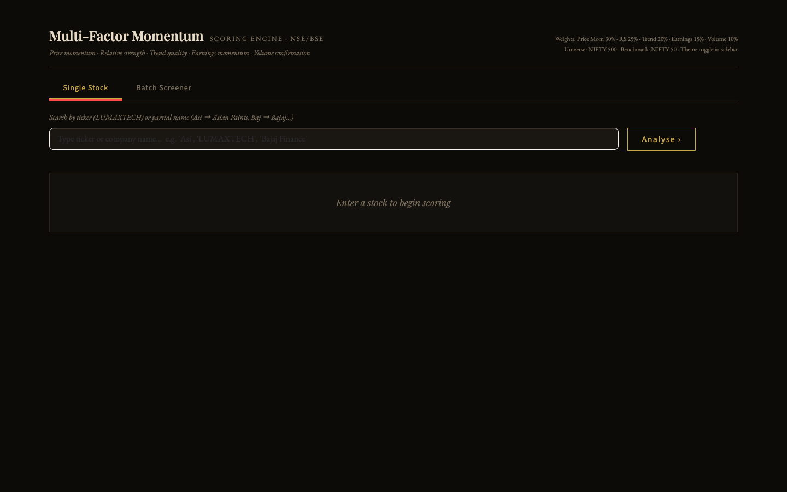

# Multi-Factor Momentum

A Streamlit app that scores NIFTY 500 stocks from 0 to 100 on five momentum factors, inspired by Minervini/O'Neil (SEPA), Druckenmiller's regime awareness and Simons-style quantitative scoring.



This is the original NIFTY 500 version. The full NSE + BSE successor, with bhavcopy prices and ISIN dedup, is the [MFM Momentum Engine v4](https://github.com/aadithyasumod/mfm_app).

## What it does

- **Scores five factors** into one composite:

  | Factor | Weight | Inputs |
  |---|---|---|
  | Price momentum | 30% | 12-1M, 6-1M, 3M, 1M returns (skip-1 convention) |
  | Relative strength | 25% | RS vs NIFTY 50 over 12M and 6M, percentile vs NIFTY 500 |
  | Trend quality | 20% | % above 200/50 EMA, proximity to 52-week high, ADX(14) |
  | Earnings momentum | 15% | EPS and revenue growth YoY, earnings surprise |
  | Volume momentum | 10% | 20/50-day volume ratio, up/down volume, breakout volume |

- **Single stock**: enter a ticker (`TCS`) or company name (`Asian Paints`) for the composite score, factor breakdown, interpretation and a 12-month chart.
- **Batch screener**: sector presets (NIFTY 50 sample, IT, Pharma, Auto) or a pasted list, ranked by composite score with a comparison chart.
- **RS rank cache**: one click fetches 12-month returns for the universe (~3–5 min) into `rs_cache.parquet`, refreshed every 7 days.
- All indicators (EMA, Wilder ADX, volume ratios) are computed from price data, with no TA-Lib dependency.

## Architecture

```
app.py (Streamlit)
  universe_builder / nifty500_tickers   NIFTY 500 universe + name -> ticker lookup
  data_fetcher                          yfinance prices and financials, indicators, RS cache
  mfm_engine                            pure scoring functions (no I/O)  ->  factor scores + composite
```

## Requirements

- Python 3.10+
- Network access to Yahoo Finance

## Run locally

```bash
make setup        # python3 -m venv venv && pip install -r requirements.txt
make run          # streamlit run app.py  ->  http://localhost:8501
```

On first run, click **Build / Refresh Cache** in the sidebar. Without it, RS rank falls back to the 50th percentile.

| Command | What it does |
|---|---|
| `make setup` | create `venv/` and install requirements |
| `make run` | start the Streamlit app |
| `make test` | byte-compile every module |

## Project structure

```
app.py               Streamlit UI
mfm_engine.py        factor and composite scoring
data_fetcher.py      yfinance data layer and indicator calculations
universe_builder.py  universe construction
nifty500_tickers.py  NIFTY 500 tickers and name aliases (add your own here)
requirements.txt
Makefile
```

## Caveats

- For analysis and education only; not investment advice.
- Earnings data comes from Yahoo's quarterly financials and may be missing for smaller stocks; the factor still scores.
